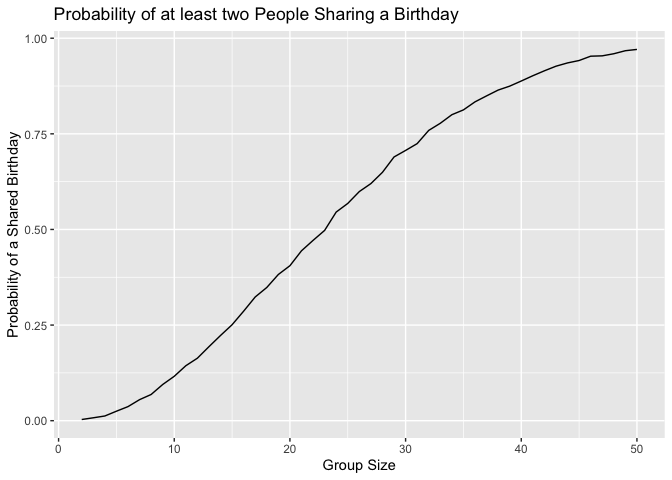
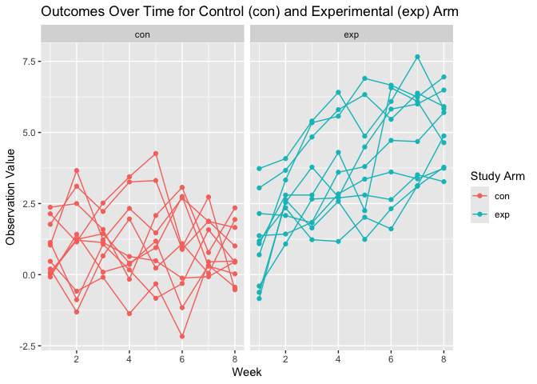
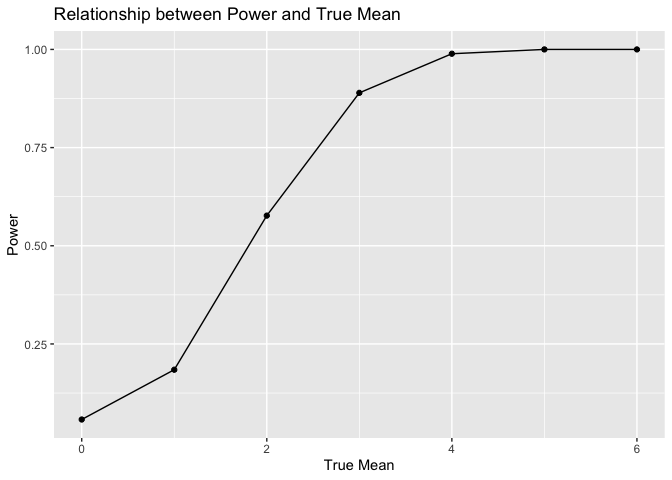
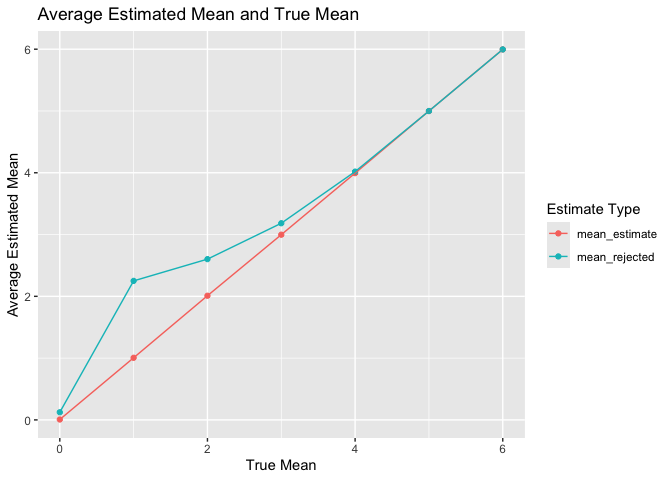

p8105_hw5_fa2818
================

``` r
library(tidyverse)
```

    ## ── Attaching core tidyverse packages ──────────────────────── tidyverse 2.0.0 ──
    ## ✔ dplyr     1.2.1     ✔ readr     2.2.0
    ## ✔ forcats   1.0.1     ✔ stringr   1.6.0
    ## ✔ ggplot2   4.0.3     ✔ tibble    3.3.1
    ## ✔ lubridate 1.9.5     ✔ tidyr     1.3.2
    ## ✔ purrr     1.2.2     
    ## ── Conflicts ────────────────────────────────────────── tidyverse_conflicts() ──
    ## ✖ dplyr::filter() masks stats::filter()
    ## ✖ dplyr::lag()    masks stats::lag()
    ## ℹ Use the conflicted package (<http://conflicted.r-lib.org/>) to force all conflicts to become errors

# Problem 1

``` r
birthday_sim = function(n) {
  birthdays = sample(1:365, size = n, replace = TRUE)
  n_distinct(birthdays) < n
}
```

``` r
birthday_results =
  expand_grid(
    group_size = 2:50,
    iter = 1:10000
  ) |>
 mutate(
    shared_birthday = map_lgl(group_size, birthday_sim)
   ) |>
  group_by(group_size) |>
  summarize(
    probability = mean(shared_birthday)
  )
```

``` r
birthday_results |>
  ggplot(aes(x = group_size, y = probability)) +
  geom_line() + 
  labs(
  title = "Probability of at least two People Sharing a Birthday",
  x = "Group Size",
  y = "Probability of a Shared Birthday"
)
```

<!-- --> The
quick increase in probability is counter-intuitive. The curve increases
quickly, with a 50% probability at around 23 people, and 90% at around
40 people

# Problem 2

``` r
longitudinal_df =
  tibble(
    files = list.files("data/"),
    path = str_c("data/", files)
  ) |> 
  mutate(
    data = map(path, read_csv)
  ) |>
  unnest(cols = data) |>
  mutate(
    files = str_replace(files, ".csv", ""),
    arm = str_sub(files, 1, 3)
  ) |>
  pivot_longer(
    week_1:week_8,
    names_to = "week",
    values_to = "outcome",
    names_prefix = "week_"
  ) |>
  mutate(
    week = as.numeric(week)
  ) |>
  select(
    subject = files, arm, week, outcome
  )
```

``` r
longitudinal_df |>
  ggplot(aes(x = week, y = outcome,
             group = subject, color = arm)) +
  geom_point() +
  geom_line() +
  facet_grid(.~arm) + labs(
  title = "Outcomes Over Time for Control (con) and Experimental (exp) Arm",
  x = "Week",
  y = "Observation Value",
  color = "Study Arm"
)
```

<!-- --> The
control group’s values are generally consistent over the eight weeks,
while the experimental group’s observations generally increase. There is
variation between individual participants in both groups, and the amount
of variation is about the same for both groups.

# Problem 3

``` r
sim_t_test = function(mu) {

sim_data = tibble(x = rnorm(30, mean = mu, sd = 5))

t.test(sim_data$x, mu = 0) |>
    broom::tidy() |>
    select(estimate, p.value)
}
```

``` r
sim_results =
  expand_grid(
    mu = 0:6,
    iter = 1:5000
  ) |>
  mutate(
    results = map(mu, sim_t_test)
  ) |>
  unnest(results) |>
  mutate(
    reject = p.value < 0.05
  )
```

``` r
power_results =
  sim_results |>
  group_by(mu) |>
  summarize(
    power = mean(reject)
  )

power_results |>
  ggplot(aes(x = mu, y = power)) +
  geom_point() +
  geom_line() +
  labs(
  title = "Relationship between Power and True Mean",
  x = "True Mean",
  y = "Power"
)
```

<!-- --> As
the population mean increases, the power increases. This makes sense,
since larger differences between the true mean and the null hypothesis
mean of zero are easier to see.

``` r
estimate_results =
  sim_results |>
  group_by(mu) |>
  summarize(
    mean_estimate = mean(estimate),
    mean_rejected = mean(estimate[reject])
  )

estimate_results |>
  pivot_longer(
    mean_estimate:mean_rejected,
    names_to = "estimate_type",
    values_to = "average_estimate"
  ) |>
  ggplot(aes(x = mu, y = average_estimate, color = estimate_type)) +
  geom_point() +
  geom_line()  +
  labs(
    title = "Average Estimated Mean and True Mean",
    x = "True Mean",
    y = "Average Estimated Mean",
    color = "Estimate Type"
  ) 
```

<!-- -->
The average estimated mean across all simulations is close to the true
mean. However, when only looking at samples where the null hypothesis
was rejected, the average estimate is generally higher than the true
mean, especially for smaller positive values of mu. This is because
samples with larger estimates are more likely to reject the null
hypothesis. As the true mean increases, the difference gets smaller
since more samples reject the null hypothesis.
